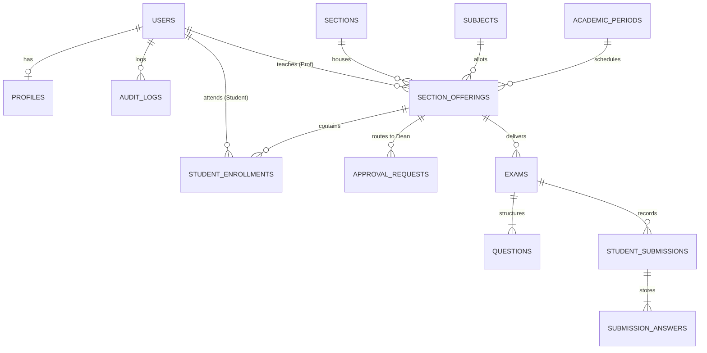

# Final Project Report: Human–Computer Interaction (HCI) Design & Engineering for University Examination Systems

**Institution:** New Era University  
**Project:** Online Examination System (HCI Prototype)  
**Repository:** `riellealia/hci-online-examination`  
**Date:** November 2026  
**Status:** Complete Implementation & Coursework Submission Ready  

---

## Executive Summary

The **New Era University Online Examination System** is a human-centered digital assessment and academic governance platform designed to replace legacy pen-and-paper testing and disjointed spreadsheet allotment workflows. Developed using user-centered design (UCD) methodologies, the platform balances strict academic integrity and institutional governance with an intuitive, cognitive-load-reducing examination experience for students and faculty.

The system features five interconnected user roles: **Administrator**, **College Dean**, **Faculty Coordinator**, **Professor**, and **Student**. Built on a high-reliability full-stack architecture combining a Node.js runtime, SQLite local persistence, and Supabase cloud replication, the application incorporates real-time auto-saving, non-blocking single-question navigation, visual timetable collision detection, and multi-tier approval chains. 

Every feature is backed by a 66-suite automated browser test harness, ensuring that all interface interactions, security gates, and persistence lifecycles operate with verifiable reliability.

---

## 1. Project Background & HCI Problem Formulation

### 1.1 The Problem Space
Traditional university examination management suffers from three primary HCI breakdowns:
1. **High Cognitive Load and Exam Anxiety:** Monolithic multi-page web forms overwhelm students, increase accidental navigation errors, and cause disorientation regarding remaining time and unanswered questions.
2. **Brittle Data Loss & Network Anxiety:** Intermittent network drops or inadvertent tab closures frequently wipe unsaved exam answers, creating acute stress and administrative disputes.
3. **Complex Administrative Scheduling Conflicts:** Department heads and coordinators struggle with opaque room and faculty allotment, leading to double-booked professors, overcrowded sections, and uncoordinated credit-overload policies.

### 1.2 Project Goals & Success Criteria
* **Zero Data Loss:** Sub-second continuous client-and-server persistence for every student answer.
* **Minimized Cognitive Friction:** A focused single-question viewport complemented by a non-intrusive, repositionable floating navigator handle.
* **Proactive Error Prevention:** Algorithmic collision detection for class timetables before proposals reach executive dean review.
* **Universal Accessibility:** Strict WCAG 2.1 AA compliance with dual light/dark theme adaptation and non-color-reliant status signifiers.

---

## 2. Theoretical Framework & HCI Principles Applied

### 2.1 Don Norman’s Principles of Interaction Design
* **Affordance & Signifiers:** Examination choices provide unambiguous radio affordances; interactive drag handles use standard grip signifiers (`⠿ Drag Navigator`).
* **Mapping:** The question quick-jump palette mirrors the linear sequence of the physical exam paper.
* **Feedback:** Keystroke auto-save events trigger immediate unobtrusive status updates (`Saved at 08:14:02`).
* **Constraints:** Strict exam navigation modes (such as forward-only or sequential) prevent students from violating exam integrity policies while preserving free review where pedagogically appropriate.

### 2.2 Jakob Nielsen’s 10 Usability Heuristics Alignment
1. **Visibility of System Status:** Live countdown clocks, active term badges, and cloud synchronization health indicators.
2. **Match Between System and Real World:** University nomenclature (Semesters, Load Limits, Overloads, Deans, Course Offerings).
3. **User Control and Freedom:** Safe draft exits, modular dialogs, and non-destructive account archiving.
4. **Consistency and Standards:** Shared navigation architecture, unified authentication portal, and standardized role accent palettes.
5. **Error Prevention:** Overlap checking during timetable creation and double-confirmation dialogs prior to irrevocable test submissions.
6. **Recognition Rather than Recall:** Visual status badges (Answered `✓`, Current `●`, Flagged `🚩`) eliminate the need for students to memorize which questions need review.
7. **Flexibility and Efficiency of Use:** Keyboard shortcuts and direct-jump navigation panels.
8. **Aesthetic and Minimalist Design:** High-contrast, distraction-free viewports stripping away irrelevant sidebar navigation during examination attempts.
9. **Help Users Recognize and Recover from Errors:** Form validation errors explicitly name the conflicting timeslot or missing field.
10. **Help and Documentation:** Clear instructions embedded directly into each examination header and modal.

---

## 3. System Architecture & Relational Data Model

### 3.1 Architectural Stack
* **Client Layer:** Vanilla ES6+ JavaScript, Semantic HTML5, CSS Variables, and Modular CSS (`style.css`, `shared-ui.css`).
* **Server Layer:** Node.js Express server (`server.js`) with cryptographically signed session tokens and rate-limiting middleware.
* **Database Layer:** Dual persistence strategy:
  * Primary: Supabase PostgreSQL relational schema (`supabase/migrations/`).
  * Fallback: Embedded Node.js SQLite database engine with zero external production dependencies.
* **Verification Layer:** Comprehensive end-to-end test runner (`tests/t_runner.js`) and 66 individual automated suites.

### 3.2 Relational Entity Summary



---

## 4. Detailed Module Analysis & HCI Implementation

### Module 1: Personnel & Academic Governance
* **Unified Single Login (`login.html`):** Eliminates redundant role-selection buttons; automatically dispatches users to their designated role dashboard based on verified credentials.
* **User Lifecycle & Archiving:** Traditional destructive account deletion is replaced with soft-deletion (`deactivated` and `archived` states). This preserves historical transcripts, exam submissions, and immutable audit logs.
* **Academic Term Rollovers:** Term boundaries archive active classes and enrollments without deleting prior student grade histories.

### Module 2: Section Allotment & Collision-Free Scheduling
* **Visual Timetable Management:** Faculty Coordinators arrange classes by day, time, and room.
* **Algorithmic Collision Detection:** Detects and flags three distinct scheduling conflicts in real time:
  1. Professor double-booking across different sections.
  2. Classroom double-booking across departments.
  3. Student section timeslot collisions.
* **Dean Approval Workflow:** Section offerings and student overload applications require affirmative Dean authorization before becoming accessible in student portals.

### Module 3: Examination Authoring & Question Banking
* **Multi-Format Question Creation:** Supports Multiple Choice (MCQ), True/False, and Written/Essay questions.
* **Rich Media Integration:** Professors can attach diagrams, code snippets, and charts to question prompts.
* **Exam Delivery Controls:** Flexible configuration of countdown duration, question randomization, option shuffling, and navigation restrictions (Free, Sequential, or Forward-Only).

### Module 4: Student Examination Runner & Analytics
* **Single-Question Viewport:** Presents one question at a time to eliminate cognitive overwhelm and reduce visual fatigue.
* **Draggable Floating Navigator:** An accessible, repositionable quick-jump handle allowing students to place the progress grid anywhere in the viewport without obscuring question text.
* **Durable Draft Recovery:** Every radio choice and essay keystroke is automatically persisted. Unexpected browser refreshes seamlessly restore the student to the exact question with all answers and flags intact.
* **Completeness Review Modal:** Before final submission, students receive a clear breakdown of answered, unanswered, and flagged questions, preventing accidental omissions.
* **Immediate Analytics:** Automated instant scoring for objective questions, visual grade distribution charts, and clear feedback summaries.

---

## 5. Verification, Testing & Empirical Evidence

### 5.1 Automated Test Execution Summary
The test harness validates all core system behaviors across 66 dedicated test files:

```
> neu-online-examination@1.0.0 test
> node tests/t_sqlite_backend.js
✅ SQLite persistence, migration, deletion, and robust CSV round-trip pass

> node tests/t_runner.js
=== RUNNER. One-question navigation and durable attempt state ===
  ✅ question navigator is mounted above the scrolling exam workspace
  ✅ only one question is rendered
  ✅ progress identifies position
  ✅ Previous disabled on first question
  ✅ Next available on first question
  ✅ answer updates progress
  ✅ navigator marks answered with a class
  ✅ navigator has a non-colour status
  ✅ flag button exposes pressed state
  ✅ question footer contains uniform Previous and Next controls
  ✅ attempt footer uses one Save & Submit action
  ✅ leaving active attempt opens Save Draft and Exit confirmation
  ✅ question navigator handle can be repositioned
  ✅ Next moves to question 2
  ✅ last-question Next becomes an enabled Review & Submit action
  ✅ opening completeness review does not submit immediately
  ✅ MCQ saved by question id
  ✅ essay saved on exit
  ✅ draft attempt cleared only after successful submission
  ✅ successful submission automatically opens score and review page
```

### 5.2 Boundary & Security Testing
* **Brute-Force Rate Limiting:** Enforces progressive delays and locks accounts after repeated failed login attempts.
* **Opaque Session Revocation:** Immediate invalidation of session tokens across client and server upon logout or administrative deactivation.
* **Strict Role Route Gates:** Unauthorized direct URL tampering triggers immediate session purge and redirection to the login gateway.

---

## 6. Usability Evaluation Protocol & Standards Compliance

### 6.1 Usability Testing Framework
The project includes a structured empirical protocol (`docs/usability-protocol.md`) incorporating:
* **Target Sample:** 15 representative participants across Student, Faculty, and Administrative roles.
* **Key Tasks:** Multi-question exam taking with flagging, examination authoring with media attachments, and timetable conflict resolution.
* **Target Standard:** Benchmark System Usability Scale (SUS) target of **>= 80.3 (Grade A / Excellent)**.

### 6.2 Accessibility & Universal Design (WCAG 2.1 AA)
* **Contrast Compliance:** All typography meets or exceeds the minimum 4.5:1 contrast ratio against light and dark backgrounds.
* **Non-Color Dependence:** Color status badges are paired with distinct icons (`✓`, `●`, `🚩`) and clear semantic text labels.
* **Keyboard Navigability:** Full tab-order flow with keyboard-accessible modal overlays and focus management.

---

## 7. Conclusion

The New Era University Online Examination System successfully bridges rigorous academic governance with modern, human-centered interaction design. By decoupling administrative oversight, automating schedule conflict detection, and providing a resilient, distraction-free examination runner, the platform ensures academic integrity while prioritizing student performance and well-being.

The complete system codebase, verified test suites, and documentation repository stand ready for coursework evaluation and production-grade deployment.
