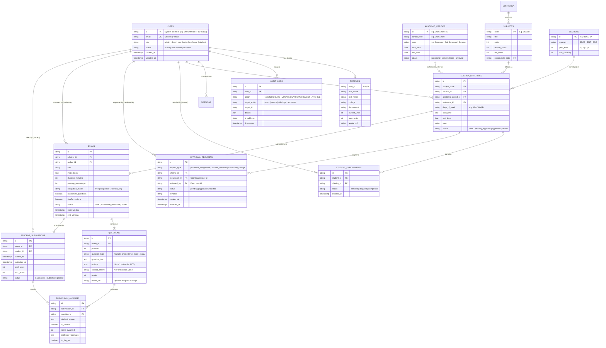

# Data Model and Entity-Relationship Architecture

## 1. Architectural Overview
The New Era University Online Examination System utilizes a relational database architecture synchronized between Supabase (PostgreSQL) and a local SQLite engine. The schema guarantees referential integrity, historical preservation through soft-deletions and audit logs, and conflict-free schedule allotments.

---

## 2. Entity-Relationship Diagram (ERD)

---

## 3. Data Dictionary and Integrity Rules

### Referential Integrity Enforcements
1. **Cascade & Restrict Safeguards**:
   * Direct record deletion is prevented when dependent active submissions, offerings, or enrollment records exist.
   * Soft-deletion (`status = 'archived'`) preserves all foreign keys for historical auditing.
2. **Schedule Conflict Checks**:
   * `SECTION_OFFERINGS` triggers evaluate `professor_id`, `room`, `days_of_week`, and `[start_time, end_time]` intervals to prevent double-booking.
3. **Student Load & Capacity Constraints**:
   * An enrollment insertion verifies current section headcount against `SECTIONS.max_capacity`.
   * Enrolling a student checks `PROFILES.current_units + SUBJECTS.units <= PROFILES.max_units`. If exceeded, enrollment is rejected unless an approved record exists in `APPROVAL_REQUESTS`.
