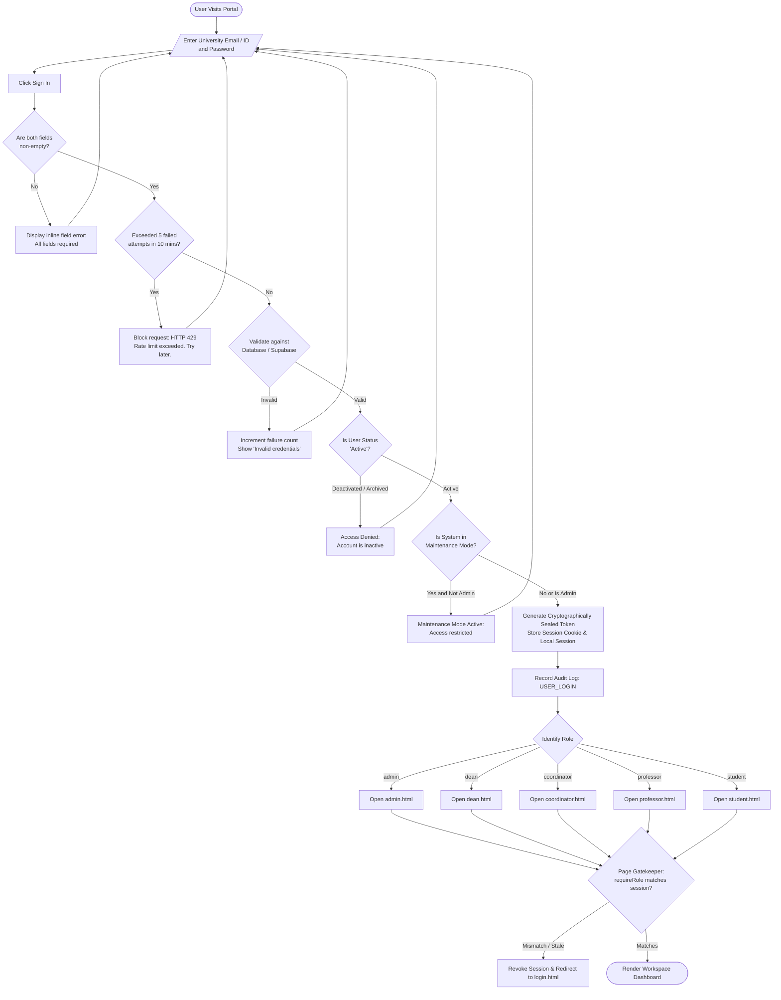
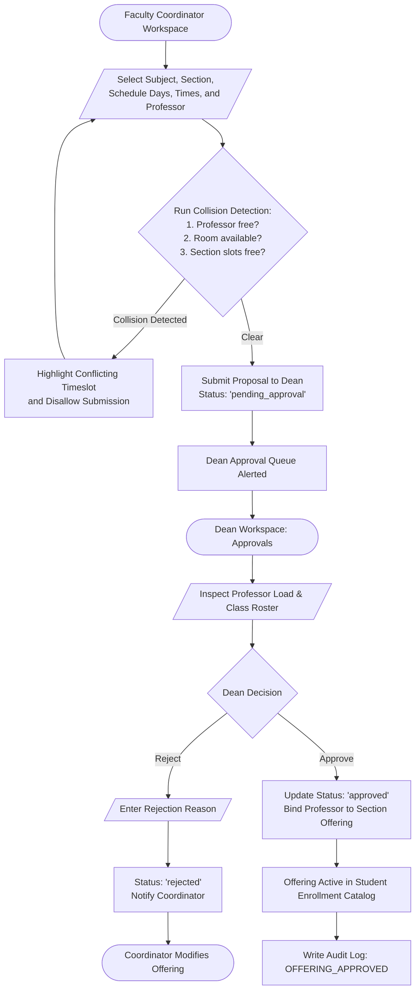
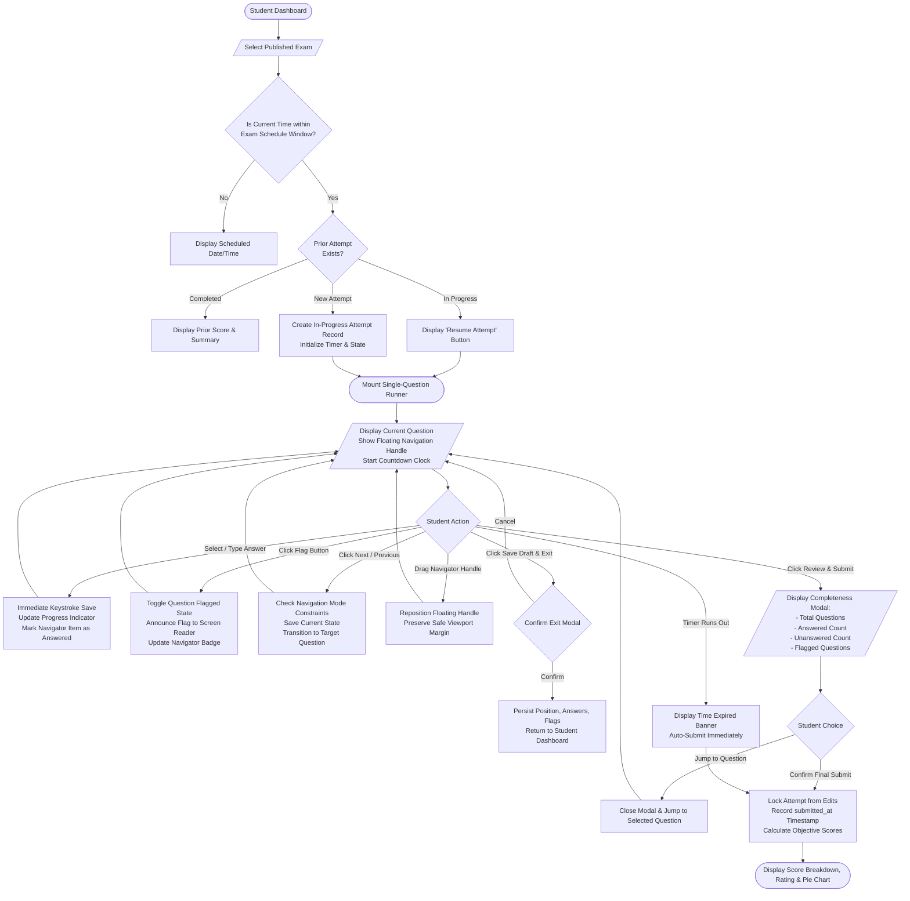

# System Flowcharts & Interaction Workflows

## 1. Unified Authentication & Role-Based Dispatch Flowchart



---

## 2. Subject Offering & Dean Approval Workflow



---

## 3. Examination Authoring & Publication Lifecycle

```mermaid
flowchart TD
    ProfStart([Professor Workspace]) --> CreateExam[/Create Exam Form:<br/>Title, Subject, Assigned Section(s),<br/>Duration, Passing %, Navigation Mode/]
    CreateExam --> SaveExamDraft[Save Draft Exam Record]
    SaveExamDraft --> AddQuestions[/Add Questions from Catalog<br/>or Create New Question/]
    AddQuestions --> QuestionType{Select Type}
    QuestionType -->|Multiple Choice| InputMCQ[/Question Text, Options, Select Correct Choice/]
    QuestionType -->|True / False| InputTF[/Question Text, Select True or False/]
    QuestionType -->|Written / Essay| InputEssay[/Prompt Text, Rubric, Max Points/]
    
    InputMCQ & InputTF & InputEssay --> AttachMedia{Attach Diagram / Image?}
    AttachMedia -->|Yes| UploadImg[Upload & Preview Media Asset] --> SaveQ[Save Question]
    AttachMedia -->|No| SaveQ
    
    SaveQ --> ReorderQuestions{Drag & Drop<br/>Reorder or Shuffle?}
    ReorderQuestions -->|Yes| UpdatePositions[Update Question Position Array] --> ReviewExam
    ReorderQuestions -->|No| ReviewExam[/Review Total Points & Exam Timing/]
    
    ReviewExam --> PublishTrigger{Click Publish?}
    PublishTrigger -->|No| KeepDraft[Keep as Editable Draft]
    PublishTrigger -->|Yes| ValidateExam{Validation:<br/>- At least 1 question?<br/>- Valid duration?<br/>- Assigned section?}
    ValidateExam -->|Fail| ShowPubErr[Display Missing Requirements Toast] --> ReviewExam
    ValidateExam -->|Pass| SetPublished[Status: 'published'<br/>Lock Question Edits]
    SetPublished --> NotifyStudents[Push Notification to Enrolled Students' Inboxes]
```

---

## 4. Student Examination Runner & Attempt State Lifecycle


